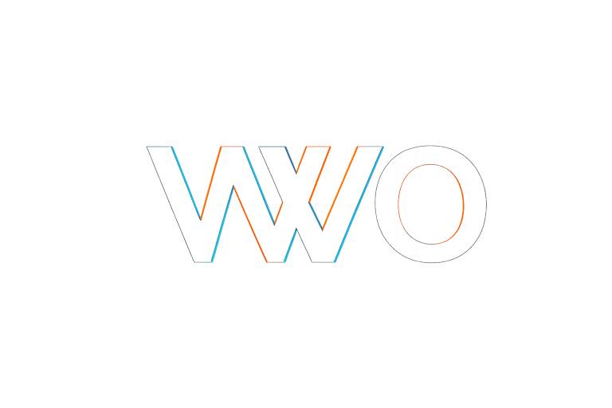
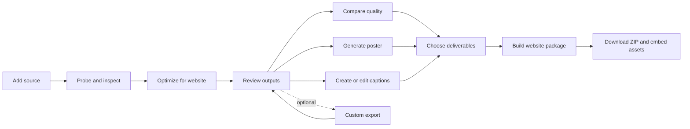
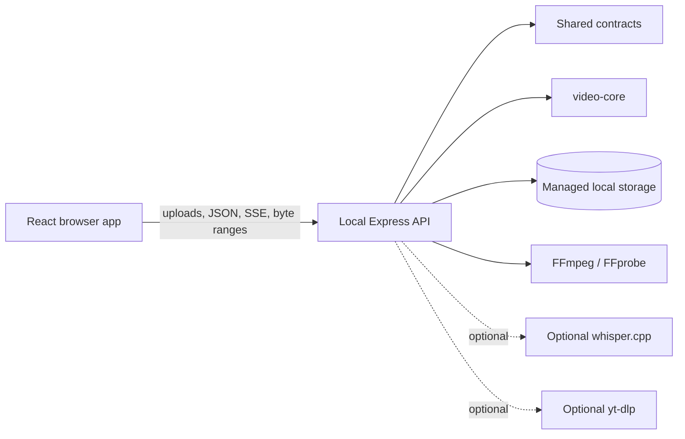
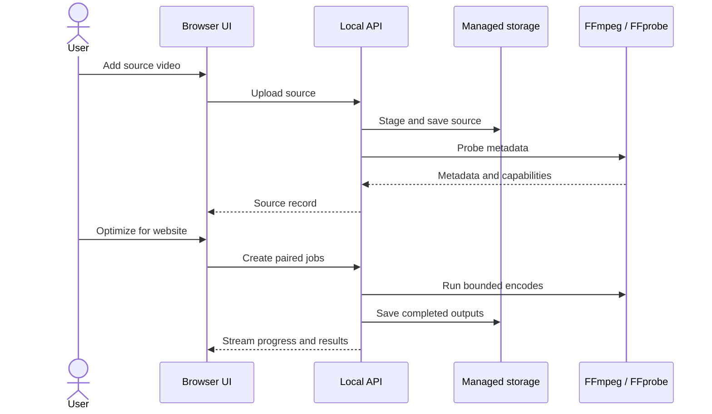
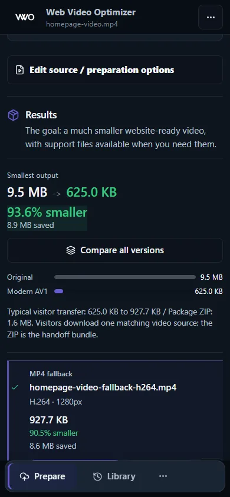

# Web Video Optimizer

<picture>
  <source media="(prefers-color-scheme: light)" srcset="apps/web/public/brand/WVO-logo-transparent.webp">
  
</picture>

[](https://github.com/Artsen/web-video-optimizer/actions/workflows/ci.yml)
[](LICENSE)


Web Video Optimizer is a local-first browser workspace for turning source videos into website-ready media packages. It runs FFmpeg on your computer, creates compatible and modern video outputs, lets you compare visual quality, and packages video, poster, caption, transcript, embed, and structured-data assets for deployment.

It is intended for web developers, content teams, marketers, and creators who need deployable web video assets without sending source media to a hosted conversion service. In the default local configuration, the browser sends media to the local WVO API process and the API keeps sources and generated files on your machine.

<picture>
  <source media="(prefers-color-scheme: light)" srcset="docs/assets/screenshots/results-light.webp">
  
</picture>

## Contents

- [Status And Scope](#status-and-scope)
- [Why WVO Exists](#why-wvo-exists)
- [Plain-English Tour](#plain-english-tour)
- [Key Capabilities](#key-capabilities)
- [Quick Start](#quick-start)
- [Workflow](#workflow)
- [Architecture At A Glance](#architecture-at-a-glance)
- [Processing Sequence](#processing-sequence)
- [What WVO Creates](#what-wvo-creates)
- [Optimization Workflows](#optimization-workflows)
- [Review And Comparison](#review-and-comparison)
- [Captions, Posters, And Packages](#captions-posters-and-packages)
- [Persistence And Managed Storage](#persistence-and-managed-storage)
- [Repository Layout](#repository-layout)
- [Development Commands](#development-commands)
- [Gallery](#gallery)
- [Privacy And Security](#privacy-and-security)
- [Current Limitations](#current-limitations)
- [Documentation Map](#documentation-map)
- [Contributing And License](#contributing-and-license)

## Status And Scope

This project is a developer beta. The core local workflow is usable and tested, but the app is intentionally focused on trusted local or LAN use rather than public hosting. There are no accounts, cloud media uploads, analytics, or hosted processing services.

| Area                      | Current state                    |
| ------------------------- | -------------------------------- |
| Local upload and probing  | Available                        |
| Recommended MP4/WebM pair | Available                        |
| Browser comparison        | Available                        |
| Posters and packages      | Available                        |
| Caption generation        | Optional local dependency        |
| YouTube import            | Optional local dependency        |
| Public hosted deployment  | Not the supported security model |
| Accounts/cloud sync       | Not included                     |

## Why WVO Exists

Preparing video for the web usually means juggling codec settings, fallback files, posters, captions, embed markup, file sizes, browser preview checks, and structured data. A generic transcoder can convert a file, but it usually does not guide the whole website handoff.

WVO is workflow-oriented rather than codec-only. It combines compatibility exports, modern compression, WebP poster generation, optional captions, transcript markup, structured data, browser comparison, persistent history, and a local browser interface around FFmpeg and FFprobe.

## Plain-English Tour

1. Add a local source or supported URL. Upload a file in the browser, drag one into the drop zone, or import a supported YouTube URL when yt-dlp is configured.
2. Review metadata and web-compatibility information. WVO shows dimensions, duration, size, codecs, audio status, subtitle tracks, and compatibility status.
3. Run the recommended website optimization. The main workflow creates a compatible H.264 MP4 fallback and a modern WebM/AV1 output.
4. Watch queued and running jobs. Jobs are scheduled through the local API, report progress, and can be canceled.
5. Compare source and outputs. Use synchronized playback to inspect quality and browser support at the same timestamp.
6. Create a poster and captions. Generate a WebP poster and, when whisper.cpp is configured, generate and edit captions.
7. Assemble the website package. Select completed outputs, poster, and captions, then add package metadata.
8. Download the ZIP and embed assets. The package includes deployable media plus `embed.html` and `README.txt`.
9. Reopen earlier sources from the Library. History is restored from the local manifest across refreshes and API restarts.

## Key Capabilities

**Source preparation**

- Local video upload.
- Optional supported YouTube URL import through yt-dlp.
- Metadata and codec inspection through FFprobe.
- Source renaming.
- Web-compatibility status.

**Optimization**

- Recommended compatible MP4 fallback and modern WebM output.
- Custom export controls for container, codec, dimensions, frame rate, quality, audio, and output name.
- Bounded media job scheduling.
- Cancelation and progress reporting.

**Review**

- Browser playback from local byte-range streams.
- Grid comparison with 1-up, 2-up, 4-up, and auto layouts.
- Wipe and A/B comparison modes.
- Synchronized comparison playback.
- Output size and savings presentation.

**Delivery**

- WebP poster generation.
- VTT and SRT caption sidecars when captions are generated.
- Caption editing and preview.
- Transcript markup.
- Embed code with `VideoObject` JSON-LD.
- Website ZIP package.

**Persistence and operations**

- History restoration from `manifest.json`.
- Managed storage cleanup.
- Startup recovery for interrupted work.
- Local health and readiness checks.

## Quick Start

### Prerequisites

- Node.js 20 or newer.
- npm.
- FFmpeg and FFprobe on PATH.
- A supported modern browser.
- Optional: Docker.
- Optional: yt-dlp for YouTube import.
- Optional: whisper.cpp and a local model for caption generation.

### Local Node

```powershell
git clone https://github.com/Artsen/web-video-optimizer.git
cd web-video-optimizer
npm ci
npm run dev
```

Expected services:

```text
Web interface: http://127.0.0.1:5173
Local API:     http://127.0.0.1:4000
Health:        http://127.0.0.1:4000/health
Readiness:     http://127.0.0.1:4000/ready
```

`npm run dev` builds shared packages, starts the API, starts the Vite application, streams both services into one terminal, shuts down the sibling process when one exits, and terminates both process trees on `Ctrl+C`. The launcher includes Windows-specific process-tree handling.

On Windows PowerShell, use `npm.cmd` if script execution policy blocks `npm.ps1`:

```powershell
npm.cmd run dev
```

### Separate Dev Consoles

```powershell
npm run dev:api
```

```powershell
npm run dev:web
```

### Docker Compose

Docker is optional for ordinary local development. When Docker is available:

```powershell
docker compose up --build
```

Open <http://localhost:5173>. The API listens on <http://localhost:4000>, and media is stored in the Docker `video_data` volume. Docker validation for this project is performed by GitHub Actions on Ubuntu.

See [Getting Started](docs/getting-started.md) for FFmpeg setup, LAN access, yt-dlp imports, and optional whisper.cpp captions.

## Workflow



## Architecture At A Glance



The browser app owns the workspace, route state, comparison UI, and package controls. The local API owns validation, storage boundaries, FFmpeg/FFprobe work, optional tool adapters, job scheduling, history, and downloads.

Shared contracts keep request and response shapes consistent between the API and web app. See [Architecture](docs/architecture.md) for the full service and storage model.

## Processing Sequence



## What WVO Creates

The recommended website workflow creates two video outputs:

- `*-fallback-h264.mp4` for broad browser compatibility.
- `*-modern-av1.webm` for modern compression.

Package ZIP contents depend on which completed jobs are selected. A typical package with videos, poster, and captions contains:

```text
example-web-package.zip
|-- example-fallback-h264.mp4
|-- example-modern-av1.webm
|-- example-poster.webp
|-- example-captions.vtt
|-- example-captions.srt
|-- example-transcript.txt
|-- embed.html
`-- README.txt
```

| Asset                         | Role                                                                          |
| ----------------------------- | ----------------------------------------------------------------------------- |
| Fallback video                | Broad browser playback path, usually H.264 MP4.                               |
| Modern video                  | Smaller modern-browser source, usually AV1 WebM.                              |
| Poster                        | WebP poster used before playback.                                             |
| Captions                      | VTT for web playback and SRT sidecar for compatibility.                       |
| Transcript                    | Plain-text transcript extracted from captions.                                |
| `embed.html`                  | Preview page and production embed snippet.                                    |
| `VideoObject` structured data | JSON-LD included in the generated embed markup.                               |
| `README.txt`                  | Package notes, selected files, accessibility notes, and publishing reminders. |

## Optimization Workflows

| Workflow             | Best for                                                                                        |
| -------------------- | ----------------------------------------------------------------------------------------------- |
| Optimize for website | Fast default path producing the recommended compatible and modern pair.                         |
| Custom Export        | Manually controlling codec, container, dimensions, frame rate, quality, audio, and output name. |

The default path is for ordinary website delivery. Custom Export is for source-specific constraints, special codec experiments, silent hero video, or alternate naming.

## Review And Comparison

The Compare workspace is a theatre-style review surface for checking visual quality, size, and browser playback at the same timestamp.

| Mode | Useful for                                                                               |
| ---- | ---------------------------------------------------------------------------------------- |
| Grid | Seeing the source and up to three outputs together in auto, 1-up, 2-up, or 4-up layouts. |
| Wipe | Dragging a center divider between the original and a selected output.                    |
| A/B  | Switching between original and output with matching playback state.                      |

Comparison supports synchronized play/pause, seeking, playback rate, loop, audio-source selection, frame stepping while paused, linked zoom, pan, and fullscreen. The URL restores selected output, mode, layout, and visible versions. Playback time, volume, zoom, pan, wipe percentage, and fullscreen are intentionally temporary review state.

See the [User Guide](docs/user-guide.md) for the full workflow.

## Captions, Posters, And Packages

FFprobe detects embedded subtitle tracks during source inspection. If no subtitle track exists and the source has audio, WVO can generate captions with local whisper.cpp when `WHISPER_CPP_BIN` and `WHISPER_CPP_MODEL` are configured.

Generated captions can be previewed over video, edited in the caption theatre, downloaded as `.vtt` and `.srt`, included in the ZIP package, or remuxed into completed MP4/WebM outputs.

Poster generation creates a WebP image from the current source. Package assembly combines selected completed jobs with title, description, language, and filename-prefix metadata.

## Persistence And Managed Storage

Sources and jobs are retained through `manifest.json`. Managed storage is separated into uploads, outputs, temporary work, and upload staging. Completed work can be reopened from the Library after browser refreshes and API restarts.

On startup, the API reconciles interrupted work, restores completed jobs with existing outputs, skips dangling entries, handles duplicates, and cleans eligible temporary or orphaned data. See [Architecture](docs/architecture.md) and [Configuration](docs/configuration.md) for storage details.

## Repository Layout

```text
.
|-- apps/
|   |-- api/                 # Express API and media services
|   `-- web/                 # React browser application
|-- packages/
|   |-- contracts/           # Shared API DTOs and schemas
|   `-- video-core/          # Reusable pure media helpers
|-- scripts/                 # Development launcher and repository scripts
|-- docs/                    # User, operator, and developer documentation
|-- e2e/                     # Playwright browser workflows
|-- data/                    # Local runtime storage, untracked
`-- .tmp/                    # Local test/review scratch space, untracked
```

## Development Commands

| Command                     | Purpose                                                                |
| --------------------------- | ---------------------------------------------------------------------- |
| `npm run dev`               | Build shared packages, then run API and web app together.              |
| `npm run dev:api`           | Build shared packages, then run the API development service.           |
| `npm run dev:web`           | Build shared packages, then run the browser app.                       |
| `npm run build`             | Build packages, API, and web.                                          |
| `npm run lint`              | Run ESLint with zero warnings allowed.                                 |
| `npm run typecheck`         | Build shared packages and run TypeScript checks across workspaces.     |
| `npm run test:run`          | Build shared packages, run script tests, and run workspace tests once. |
| `npm run test:e2e`          | Run Playwright browser workflows through the project E2E runner.       |
| `npm run review:ui-screens` | Capture deterministic UI review screenshots into `.tmp/ui-review/`.    |
| `npm run check`             | Run format check, lint, typecheck, tests, and build.                   |

See [Testing](docs/testing.md) for coverage, audit, browser, and real-media integration commands.

## Gallery

| Prepare                                                                                                                         | Results                                                                                                     | Compare                                                                                                                         |
| ------------------------------------------------------------------------------------------------------------------------------- | ----------------------------------------------------------------------------------------------------------- | ------------------------------------------------------------------------------------------------------------------------------- |
|  |  |  |

Prepare demonstrates source admission, local metadata, and the main website workflow. Results demonstrates completed artifacts, selected output details, and package readiness. Compare demonstrates quality review with synchronized media controls.

| Custom Export                                                                                                                            | Mobile                                                                                                                       |
| ---------------------------------------------------------------------------------------------------------------------------------------- | ---------------------------------------------------------------------------------------------------------------------------- |
|  |  |

Custom Export demonstrates advanced settings for manual exports. Mobile demonstrates the same information architecture adapted to compact navigation.

## Privacy And Security

WVO is local-first, not browser-only. The browser communicates with the local WVO API. The API invokes FFmpeg/FFprobe, writes sources and outputs to managed local storage, and serves previews and downloads back to the browser.

By default, source and output media remain within managed local storage on the user's machine. Optional yt-dlp import contacts the provided service because it downloads from the URL you provide. Optional whisper.cpp caption generation runs locally with the configured executable and model.

The API has no authentication because public hosting is not the supported mode. LAN binding must be explicitly enabled with `ALLOW_LAN_ACCESS=true` and matching `CORS_ORIGIN` values, and should only be used on trusted networks.

See [Privacy](PRIVACY.md) and [Security](SECURITY.md).

## Current Limitations

WVO is still a developer beta for trusted local or trusted LAN use. It has no accounts or cloud sync. FFmpeg and FFprobe are required for core media work; caption generation requires optional whisper.cpp and a local model; URL import requires optional yt-dlp and contacts the source service. Processing speed depends on source media, codec, settings, and hardware. Browser playback support may differ from encoding support. Docker Compose startup is validated in GitHub Actions on Ubuntu, but local platform behavior can still vary.

## Documentation Map

**Users:** [Getting Started](docs/getting-started.md), [User Guide](docs/user-guide.md), and [Troubleshooting](docs/troubleshooting.md).

**Operators:** [Configuration](docs/configuration.md), [Privacy](PRIVACY.md), and [Security](SECURITY.md).

**Developers:** [Architecture](docs/architecture.md), [API Reference](docs/api.md), and [Testing](docs/testing.md).

**Project governance:** [Contributing](CONTRIBUTING.md), [Code of Conduct](CODE_OF_CONDUCT.md), [Changelog](CHANGELOG.md), and [Support](SUPPORT.md).

WVO's current visual and interaction system is documented in [Brand System](docs/brand-system.md). The checked-in slate/iris/ember system and fused WVO monogram are the canonical product identity.

## Contributing And License

Contributions are welcome while the app is in developer beta. Please read [Contributing](CONTRIBUTING.md) before opening a pull request, especially the notes about not committing local media, generated output, coverage, screenshots under `.tmp/`, or environment files.

MIT. See [LICENSE](LICENSE).
