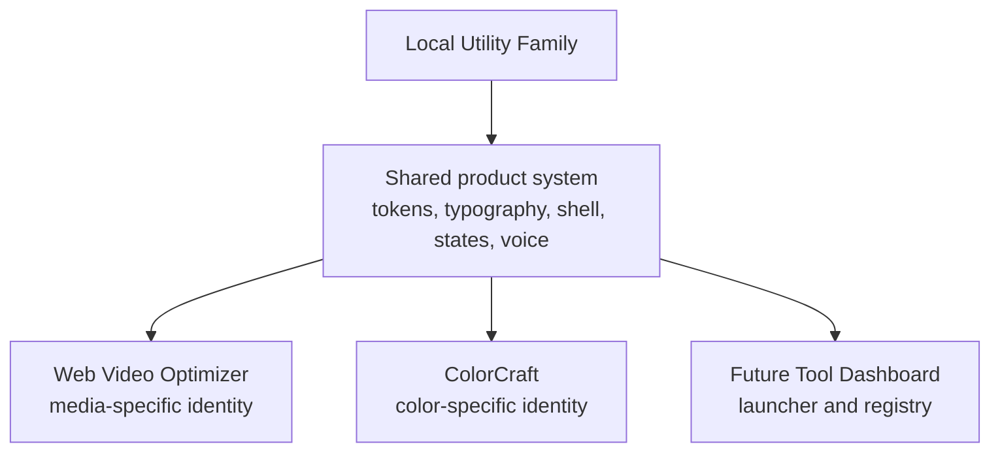
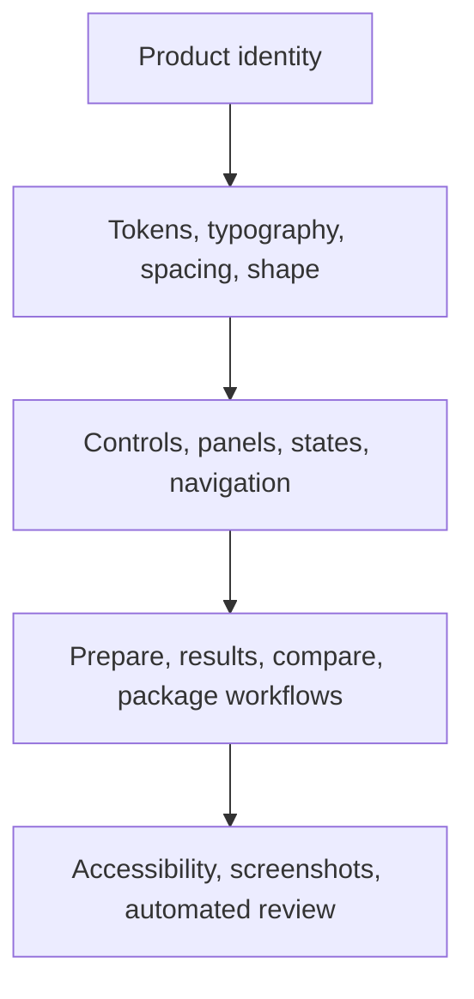

# Brand System

This document defines the canonical visual, interaction, and product-language system for the current Web Video Optimizer application. Older logo explorations, green-primary palettes, clapperboard marks, mockups, or brand documents should be treated as historical unless explicitly incorporated here.

Web Video Optimizer uses a "precision slate with a controlled spectral transformation" direction: calm local tooling, clear media operations, and restrained moments of color where work is selected, processing, or complete.

## Purpose And Scope

This is a product-interface system, not only a logo guide. It governs:

- Product identity.
- Application chrome.
- Logo usage.
- UI color.
- Typography.
- Layout.
- Components.
- Interaction states.
- Motion.
- Accessibility.
- Writing style.
- Documentation imagery.
- Relationship to future sibling tools.

Checked-in implementation remains the source of truth for runtime behavior. This document names the intended design language so future changes can stay coherent.

## Brand Idea

Precision slate with a controlled spectral transformation.

- **Precision:** exact media operations, trustworthy measurements, clear statuses, and visible consequences.
- **Slate:** quiet neutral surfaces that let the user's media stay visually dominant.
- **Spectral transformation:** restrained iris-to-ember moments that communicate conversion, movement, and source-to-result comparison.
- **Local:** privacy, ownership, reliability, and visibility into what is happening on this computer.

WVO should feel:

- Calm
- Technical
- Precise
- Capable
- Honest
- Local-first
- Non-theatrical
- Outcome-focused

WVO should not feel:

- Flashy
- Cyberpunk
- Neon-heavy
- Overly playful
- Enterprise-bureaucratic
- AI-generated marketing language
- Vague or overpromising
- Colorful merely for decoration

The intended balance is roughly 80% slate structure, 15% tonal elevation and borders, 4% iris interaction, and 1% ember accent.

## Brand Hierarchy And Future Tool Family

WVO retains its own product name and fused WVO monogram. Future sibling tools should have their own names and marks.

Shared family resemblance should come from tokens, typography, shape, interaction patterns, application shell behavior, status semantics, and writing voice. Other tools should not reuse the WVO monogram as a suite logo. The WVO spectral logo treatment is product identity, not a generic decoration applied throughout every tool.

The slate/iris/ember interface system can serve as the starting point for a future shared local-tool design system. Domain content may introduce richer color where appropriate, but application chrome should remain restrained.

This is a conceptual direction, not an implemented repository architecture:



## Visual System Hierarchy



## Logo Rules

The approved mark is a fused WVO monogram. The W and V share overlapping geometry, while the O acts as the terminal output form. The chromatic cyan and ember edge separation is part of the artwork and should remain intact.

Canonical app and documentation assets live in `apps/web/public/brand/` so the Vite app, favicon, README, and packaged static paths use the same source files.

| Asset                             | Use                                                              |
| --------------------------------- | ---------------------------------------------------------------- |
| `WVO-logo-transparent.webp`       | Dark letterform variant for light surfaces.                      |
| `WVO-logo-white-transparent.webp` | White letterform variant for dark surfaces.                      |
| `WVO-favicon.png`                 | Small browser chrome favicon derived from the approved monogram. |

Primary lockup: the monogram paired with visible `Web Video Optimizer` text. This is used in the sidebar, mobile top bar, workspace header, README hero, and documentation.

Secondary lockup: the monogram by itself. This is acceptable for favicon use, compact chrome where the product name is already visible nearby, or small app marks with an accessible text label elsewhere in the same control.

When the mark sits next to visible `Web Video Optimizer` text, it should be `aria-hidden` to avoid duplicate announcements. Use a useful text alternative for standalone documentation imagery. Do not rely on the image alone to name the product in navigational controls.

Sizing guidance:

| Placement          | Practical rendered width                               |
| ------------------ | ------------------------------------------------------ |
| Favicon            | Browser-controlled favicon dimensions.                 |
| Mobile header      | About 48px.                                            |
| Sidebar chrome     | About 54px to 58px.                                    |
| Workspace header   | About 72px to 86px.                                    |
| Documentation hero | About 180px to 360px.                                  |
| Empty state        | Large enough to be recognizable, but paired with text. |

Clear space should be at least one quarter of the visible monogram width on all sides. Use the dark asset on light surfaces and the white asset on dark surfaces. Backgrounds should be quiet slate, white, or transparent. Do not place the logo over busy media or high-contrast patterns.

Do not:

- Recreate the logo using text.
- Rotate, stretch, crop, or distort the mark.
- Recolor the cyan and ember edge treatment.
- Separate the cyan and ember edges from the letterform.
- Use the logo gradient as an ordinary button background.
- Put the logo inside a colored tile by default.
- Animate the logo continuously.
- Use the mark as a loading spinner.
- Place the mark on busy media without a quiet background.
- Let sibling applications use the WVO mark.

The logo's cyan and ember edges do not redefine the product palette. The interface remains slate, iris, and ember.

## Color And Token Architecture

Dark theme:

| Token                      | Value     |
| -------------------------- | --------- |
| `--color-app-bg`           | `#080c12` |
| `--color-sidebar-bg`       | `#090e15` |
| `--color-workspace-bg`     | `#0e151f` |
| `--color-surface`          | `#141d29` |
| `--color-surface-elevated` | `#1a2533` |
| `--color-surface-recessed` | `#0c121b` |
| `--color-surface-hover`    | `#202c3c` |
| `--color-surface-selected` | `#1c2440` |
| `--color-primary`          | `#6a5bcf` |
| `--color-ember`            | `#f2763f` |
| `--color-success`          | `#35c981` |
| `--color-info`             | `#5aa7ff` |
| `--color-warning`          | `#e8b44d` |
| `--color-danger`           | `#f06a72` |

Light theme:

| Token                      | Value     |
| -------------------------- | --------- |
| `--color-app-bg`           | `#f2f4f7` |
| `--color-sidebar-bg`       | `#e9edf2` |
| `--color-workspace-bg`     | `#ffffff` |
| `--color-surface`          | `#ffffff` |
| `--color-surface-elevated` | `#ffffff` |
| `--color-surface-recessed` | `#eef1f5` |
| `--color-surface-hover`    | `#e5eaf0` |
| `--color-surface-selected` | `#eeeafe` |
| `--color-primary`          | `#5848b8` |
| `--color-ember`            | `#b84c1f` |
| `--color-success`          | `#187a4b` |
| `--color-info`             | `#2463c5` |
| `--color-warning`          | `#8b5c00` |
| `--color-danger`           | `#b72c3b` |

The canonical spectral gradient is:

```css
linear-gradient(120deg, #5f6fe5 0%, #765bc8 54%, #e66a3a 100%)
```

Token groups:

- **Application structure:** app, sidebar, workspace, surface, recessed, elevated, hover, selected.
- **Text hierarchy:** primary, secondary, subtle, disabled.
- **Interaction:** primary, primary hover, primary pressed, focus ring.
- **Transformation:** ember, ember bright, spectral gradients.
- **Status:** success, info, warning, danger.
- **Media:** media background, overlays, scrims.
- **Borders and overlays:** subtle, strong, emphasis, overlay, scrim.
- **Gradients:** brand spectral, processing, ambient field.

| Purpose             | Token                       | Appropriate use                                             |
| ------------------- | --------------------------- | ----------------------------------------------------------- |
| Primary interaction | `--color-primary`           | Main actions, focus, selected states.                       |
| Transformation      | `--color-ember`             | Active processing or source-to-output emphasis.             |
| Success             | `--color-success`           | Completed output or valid result.                           |
| Information         | `--color-info`              | Neutral capability or help status.                          |
| Warning             | `--color-warning`           | Degraded capability or caution.                             |
| Danger              | `--color-danger`            | Failure and destructive action.                             |
| Brand accent        | `--gradient-brand-spectral` | Logo-adjacent accents and selected transformation emphasis. |
| Processing          | `--gradient-processing`     | Progress where conversion is actively happening.            |

`--color-primary` is iris. It is for interaction and selection. `--color-ember` is transformation. It should not replace warning or destructive color. `--color-success` is green and only means genuine completion, validity, or healthy state. `--gradient-brand-spectral` is a brand accent; `--gradient-processing` is currently the same gradient used for progress.

Appropriate examples:

- Use iris for the primary `Optimize for website` action.
- Use the processing gradient in a progress bar.
- Use success for completed output and storage health.
- Use warning when FFmpeg is missing, storage is low, or compatibility needs review.
- Use danger for failed jobs and deletion.

Inappropriate examples:

- Do not use ember for destructive delete controls.
- Do not use success green as the primary brand color.
- Do not fill every button with the spectral gradient.
- Do not use color alone to communicate status.
- Do not add extra decorative colors to application chrome.

## Typography

The app uses a system stack centered on Segoe UI Variable, Segoe UI Variable Text, Segoe UI, Inter when locally available, system-ui, and sans-serif. Monospace text uses ui-monospace, SFMono-Regular, Consolas, Liberation Mono, and monospace.

Hierarchy should be created primarily through size, weight, spacing, and grouping. Avoid excessive color, uppercase text, and badges.

| Role          | Token                  | Use                                            |
| ------------- | ---------------------- | ---------------------------------------------- |
| Product title | `--font-product-title` | Sidebar and compact product naming.            |
| Page title    | `--font-page-title`    | Workspace header title.                        |
| Section title | `--font-section-title` | Major panels and feature sections.             |
| Card title    | `--font-card-title`    | Output rows, compact headings, cards.          |
| Body          | `--font-body`          | Main explanatory copy.                         |
| Compact body  | `--font-body-compact`  | Dense panels, help copy, descriptions.         |
| Metadata      | `--font-metadata`      | File details, small status labels, timestamps. |
| Metrics       | `--font-metric`        | Sizes, savings, headline measurements.         |
| Code          | `--font-code`          | Commands, filenames, paths, snippets.          |

Writing rules:

- Filenames should remain sentence-case as entered and wrap or truncate safely.
- Codec names should use their real labels: `H.264`, `AV1`, `VP9`, `AAC`, `Opus`, `libx264`, `libaom-av1`, `libopus`.
- Dimensions should use `1280 x 720` in prose and UI text when possible.
- Durations should use compact readable labels such as `0:41` or `1m 05s` depending on context.
- File sizes should be human-readable and include units.
- Button labels should describe the action: `Optimize for website`, `Create package`, `Download original`.
- Technical metadata can be dense, but it should stay scannable and should not become promotional copy.

## Shape, Spacing, And Elevation

The spacing system is derived from 4px increments:

- `--space-1`: 4px
- `--space-2`: 8px
- `--space-3`: 12px
- `--space-4`: 16px
- `--space-5`: 20px
- `--space-6`: 24px
- `--space-7`: 32px
- `--space-8`: 40px
- `--space-9`: 48px

Radii:

- Controls use `--radius-control` at 8px.
- Cards use `--radius-card` at 10px.
- Media uses `--radius-media` at 8px.
- Dialogs use `--radius-dialog` at 12px.
- Major empty states and theater surfaces use `--radius-hero` at 14px.
- Pills use `--radius-pill`.

Dark mode relies on tonal elevation and borders more than shadows. Shadows are restrained and reserved for dialogs, floating mobile navigation, and true overlays. Nested cards should be limited. Prefer one parent panel with recessed fields or rows over multiple card-within-card layers.

## Application Shell

The WVO shell is made of:

- Desktop sidebar.
- Workspace.
- Workspace header.
- Current-source context.
- Recent-source area.
- Theme control.
- Mobile top bar.
- Mobile bottom navigation.
- Contextual bottom action area.

Sidebar navigation communicates place. Workflow pills communicate progress or mode. The topbar communicates current context. Content panels communicate tasks. Mobile navigation must preserve the same information architecture rather than merely collapse desktop controls.

Verified responsive breakpoints:

- At `1280px` and below, the sidebar narrows and multi-column work areas collapse.
- At `1024px` and below, the desktop sidebar is replaced by a mobile top bar and bottom navigation.
- At `768px` and below, media controls, comparison, results, settings, package, and history layouts become single-column or mobile-focused.
- At `430px` and below, compact header and lightbox controls tighten further.

## Components And Interaction Grammar

| Pattern            | Use                                                       | Avoid                                                 |
| ------------------ | --------------------------------------------------------- | ----------------------------------------------------- |
| Primary button     | One dominant action in a task area.                       | Multiple competing primary actions in the same panel. |
| Secondary button   | Normal actions that are not the main next step.           | Styling destructive work as neutral.                  |
| Quiet button       | Low-emphasis utility and reset actions.                   | Hiding important workflow actions.                    |
| Icon button        | Compact known actions with accessible names or titles.    | Unlabeled unfamiliar actions.                         |
| Destructive action | Delete, remove, cancel where data or work may be lost.    | Ember or success styling.                             |
| Status badge       | Short state with text and icon support.                   | Color-only state.                                     |
| Notice             | Errors, warnings, degraded startup, recoverable problems. | Browser alerts as primary app messaging.              |
| Panel              | A bounded task or information area.                       | Deeply nested cards.                                  |
| Drop zone          | File upload and source preview.                           | General empty-state decoration.                       |
| Field              | Metadata, settings, and compact source details.           | Long prose blocks.                                    |
| Metric             | Sizes, savings, counts, durations.                        | Decorative numbers without context.                   |
| Progress           | Queued and running work.                                  | Fake activity for idle states.                        |
| Context menu       | Secondary row actions.                                    | Primary workflow commands.                            |
| Dialog             | Focused overlays such as poster preview.                  | Replacing ordinary page content.                      |
| Selected row       | Current source or output selection.                       | Selection that relies only on background color.       |
| Empty state        | No source, no history, unavailable route.                 | Marketing hero copy.                                  |

Only one dominant primary action should appear per task area. Destructive actions remain visually and semantically distinct. Selected state must not rely only on background color. Status must include text or icon support. Hover should not cause distracting movement. Disabled controls should remain readable. Browser alerts should not replace application notices.

## Motion

Motion communicates state, not personality by itself.

- Use existing motion tokens: `--motion-fast`, `--motion-base`, and `--motion-slow`.
- Processing animation may use the spectral direction.
- No decorative continuous animation in operational workspaces.
- Honor `prefers-reduced-motion`.
- Avoid hover scaling for ordinary controls.
- Progress and state changes should not shift surrounding layout unexpectedly.
- Dialog and overlay motion should be brief and should preserve focus behavior.

## Writing Voice

WVO copy should:

- Lead with the task or outcome.
- Use plain technical language.
- State what happens locally.
- Explain consequences before destructive actions.
- Describe errors with a recovery action.
- Avoid inflated claims such as "revolutionary", "perfect", "magic", or "intelligent".
- Avoid unexplained jargon.
- Avoid vague AI-style headings such as "Unlock the power of".

Approved examples:

- `Optimize for website`
- `Create package`
- `Download original`
- `FFmpeg was not found. Install it or configure its path.`
- `This URL points to a source ID that is not in the local library on this computer.`
- `Caption generation needs whisper.cpp and a model.`

Disallowed examples:

- `Begin advanced transformation`
- `Unleash perfect video magic`
- `Something went wrong`
- `AI-powered optimization engine`
- `Revolutionary media workflow`

The brand document governs product voice and interface tone. [WVO Technical English](writing-style.md) governs procedural and technical documentation. The two standards are complementary: product and brand writing can explain design rationale, while setup, configuration, troubleshooting, API, and support documentation should use controlled terminology and direct procedures.

## Accessibility And Review

Normal text should meet at least 4.5:1 contrast and large text at least 3:1. Status must not rely on color alone.

Accessibility requirements:

- Keyboard navigation reaches every interactive control.
- Focus visibility remains clear in dark, light, and forced-colors modes.
- Forced colors receive readable simplified treatments.
- Reduced motion receives static or simplified treatments.
- Status includes text or icon support.
- Dialogs manage focus and restore focus when closed.
- Icon-only controls have accessible names.
- Media controls expose play, pause, seek, speed, mute, and captions where applicable.
- Responsive controls remain large enough to operate and text remains readable.
- Screenshot review should check both structure and readability.
- Playwright and axe checks remain part of release review.

Do not remove focus outlines. Do not communicate completion, warning, or failure with color alone.

## Documentation And Screenshot Rules

Curated README screenshots are stored in `docs/assets/screenshots/`. Full deterministic review captures are generated into `.tmp/ui-review/` by `npm run review:ui-screens` and must not be committed.

Screenshot rules:

- Screenshots must represent the current UI.
- Screenshots must use mocked review fixtures.
- Dark and light captures should demonstrate equivalent information architecture.
- Avoid screenshots that merely repeat the same page state.
- Use descriptive alt text focused on what the interface demonstrates.
- Do not decorate screenshots with arbitrary external frames unless needed for explanatory documentation.
- README diagrams should use the same restrained terminology as the app.
- The screenshot set should cover dark and light themes, Prepare, Results, Compare, Custom Export, mobile, startup failure, degraded startup, processing, completed, warning, and selected-output states when those states are relevant to the documentation task.

WVO's current direction remains precision slate, controlled spectral transformation, slate-dominant chrome, iris for primary interaction, ember used sparingly for transformation, green only for genuine success, and blue, amber, and red reserved for semantic information, warning, and failure.
