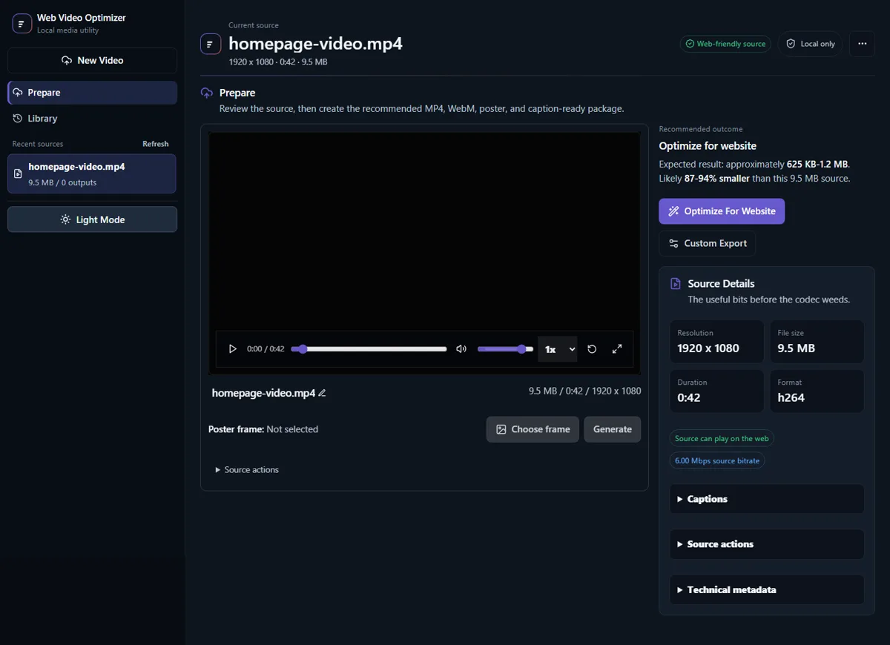
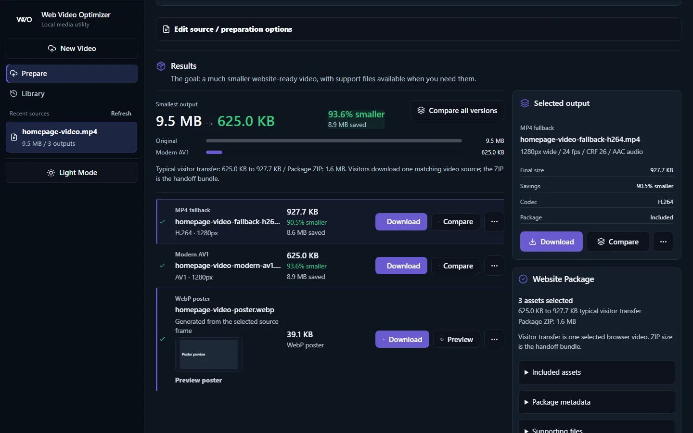
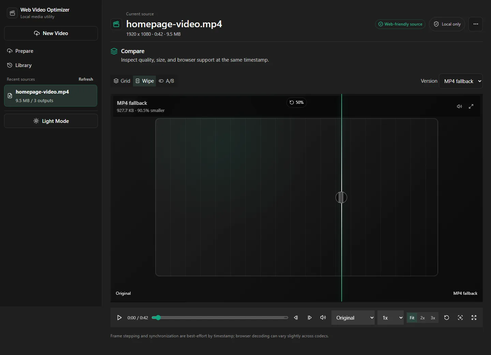
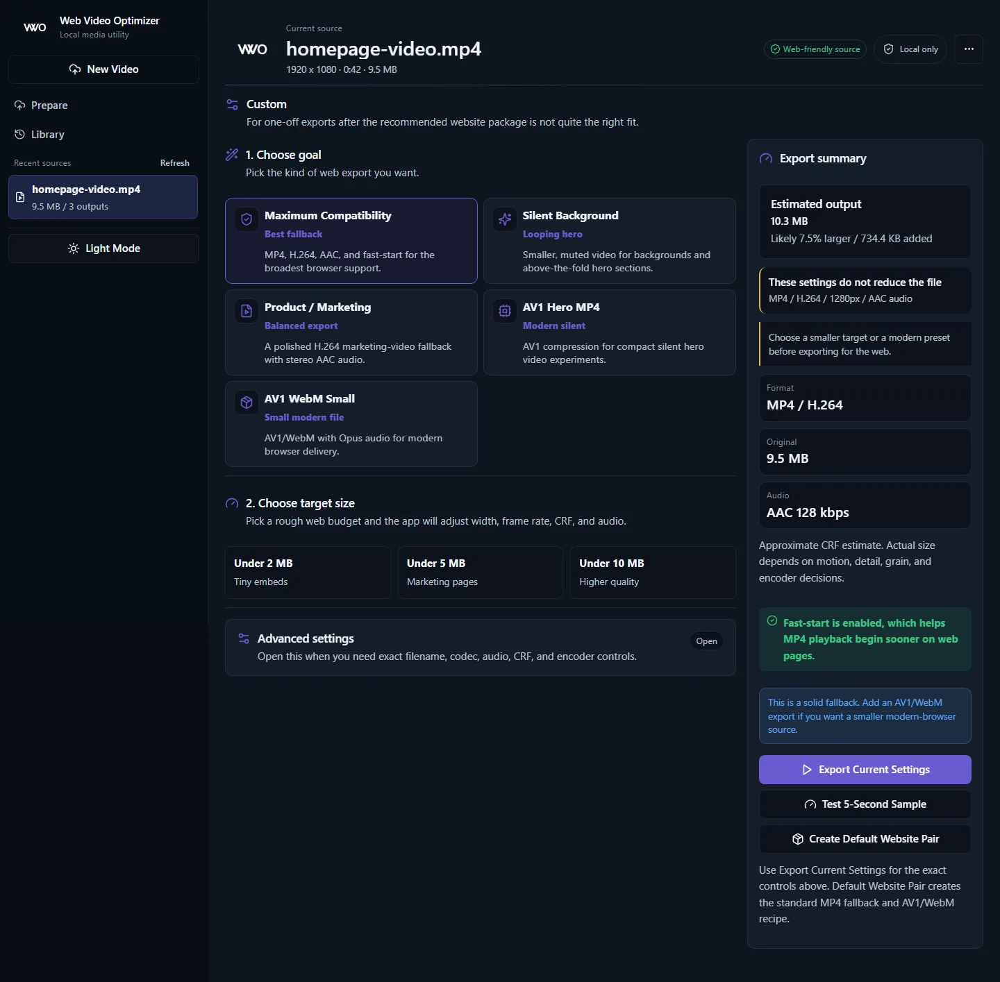

# User Guide

Web Video Optimizer is built around a source workspace. Prepare is where you add or review a source video. Results is where completed outputs, website packages, captions, and comparison tools become useful.

## Add A Source

Use the Prepare view to upload a source video by choosing a file or dragging one into the upload area. If yt-dlp is configured, paste a supported YouTube URL and let the API import the source video.

Result: After WVO admits the source video, WVO shows dimensions, duration, codecs, audio status, embedded subtitle tracks, and estimated source size. The user can rename the source without changing the underlying media content.

## Optimize For Website

The Optimize for website workflow creates two outputs:

- Create an MP4 fallback.
- Create a modern WebM output.

Jobs are queued through the API scheduler. Progress appears in the Results workspace and survives browser refreshes through the saved history manifest.

## Review Results

In Results you can:

- Select an output.
- Preview a video output or poster output.
- Download the source video or completed outputs.
- Rename completed output filenames.
- Cancel queued or running jobs.
- Delete outputs or sources.
- Create posters, captions, remuxed subtitle outputs, and website packages.
- Copy generated embed code.

Processed historical sources open directly to Results. New or unprocessed sources open to Prepare.

## Compare Outputs

Compare is a theatre-style view for checking visual quality. It supports Grid layouts, Wipe comparison, and A/B comparison. Playback can be synchronized across videos.

The URL restores selected output, mode, layout, and visible versions. Playback time, volume, zoom, pan, wipe position, and fullscreen are intentionally treated as temporary review state.

## Create Posters

Generate a WebP poster from the source video. The poster can be previewed in a lightbox, downloaded, and included in the website package.

## Captions And Subtitles

If FFprobe finds embedded subtitle tracks, the app reports them. If no subtitle track exists and the source has audio, the app can generate captions with local whisper.cpp when configured.

Generated captions can be:

- Previewed over the video.
- Edited in the caption theatre.
- Downloaded as `.vtt` or `.srt`.
- Included as caption files in the website package.
- Remuxed into completed MP4 or WebM outputs.

## Website Package

The package job creates a website package for website handoff. The website package can include optimized videos, poster artwork, caption files, transcript markup, and SEO-friendly `VideoObject` structured data.

The embed snippet uses local relative filenames so the video, poster, and captions can be served from the same site directory.

## Custom Export

Custom Export lets the user choose container, codec, width, frame rate, CRF, preset, audio mode, bitrate, sample rate, channel count, fast-start, metadata stripping, and output filename. Use Custom Export when the default website pair is not the right fit.

## Library And Storage

The Library view shows previous sources and jobs from the manifest. The user can reopen sources, delete old sources or outputs, and run storage cleanup for stale temporary files.

The API stores managed media under `STORAGE_ROOT`; Docker uses the `video_data` volume.
